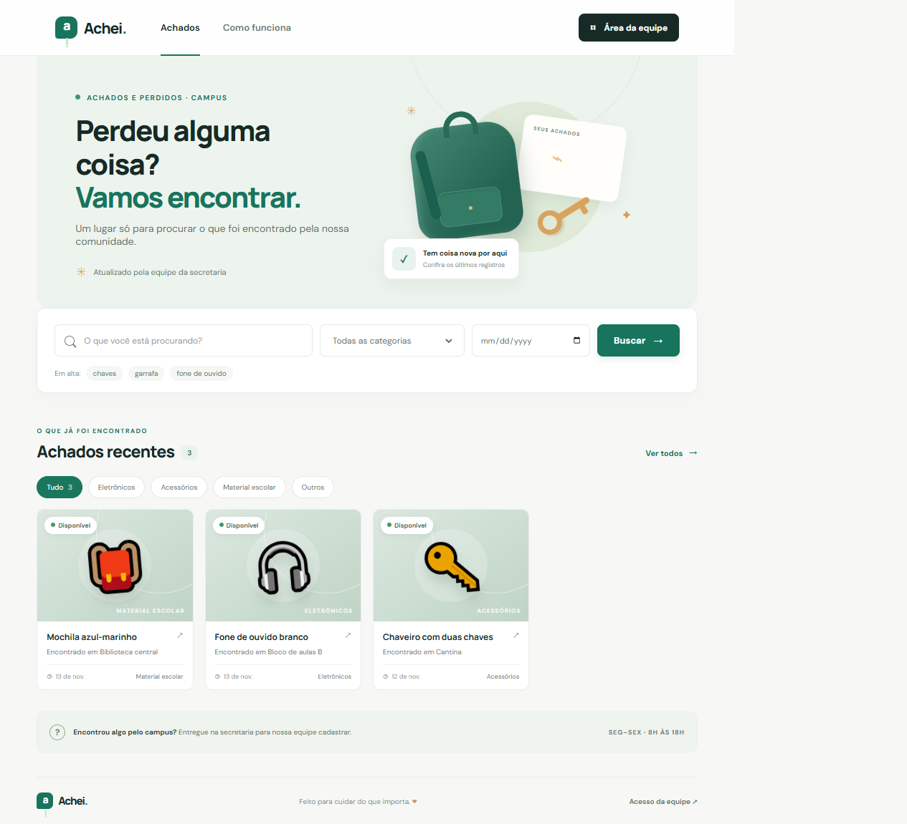
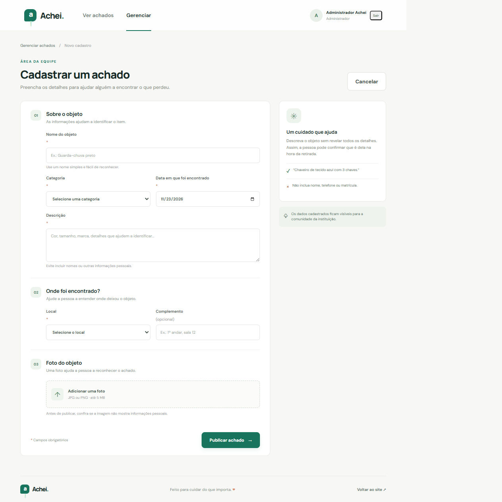
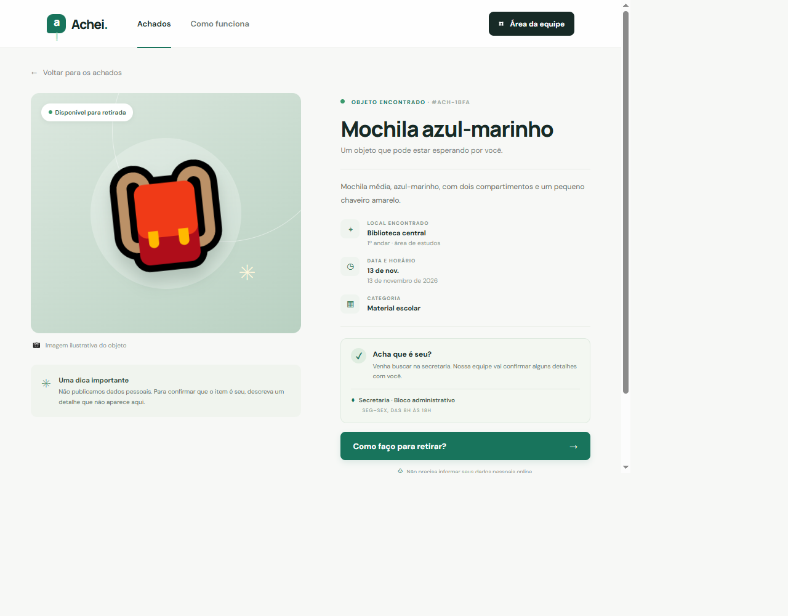
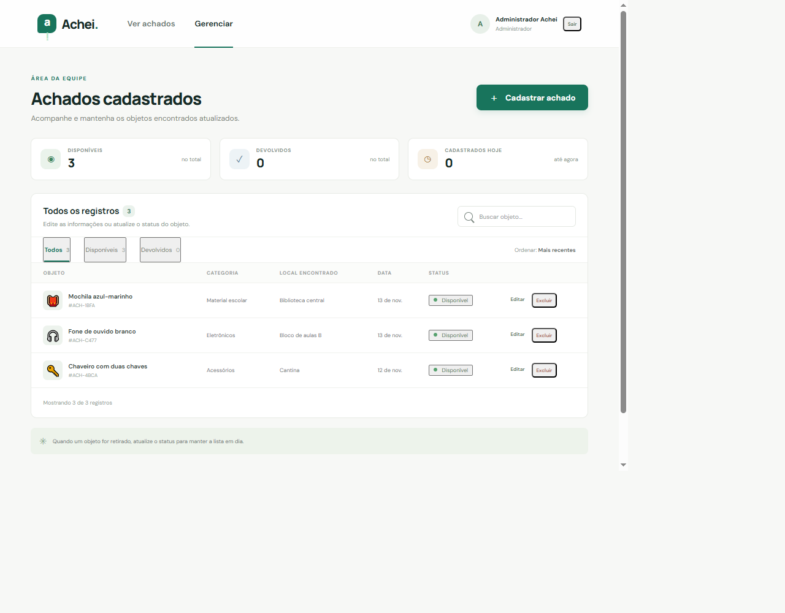

Achei! — Sistema de Achados e Perdidos

Exercício 01 — Sistema selecionado para executar

Tipo: Documento de requisitos gerado por IA e validado por humanos
Projeto: Achei! — Sistema de Achados e Perdidos
Versão: 1.0
Escopo: MVP (Produto Mínimo Viável)

01. CONTEXT — Contexto

Atualmente, estudantes, professores e funcionários enfrentam dificuldades para localizar e recuperar objetos perdidos dentro da instituição de ensino. O processo geralmente depende de buscas presenciais e perguntas aos funcionários, pois não existe um registro centralizado que facilite a identificação dos objetos encontrados. Para solucionar esse problema, propõe-se o desenvolvimento do Achei!, um sistema web responsivo que permitirá cadastrar, consultar, pesquisar, atualizar e excluir registros de objetos encontrados. O público-alvo inicial será composto por estudantes e funcionários de uma única instituição de ensino no Brasil. O MVP deverá ser simples, acessível por computadores e celulares, com funcionalidades essenciais, controle de acesso às operações administrativas e atenção à proteção dos dados pessoais conforme a LGPD.

Objetivo do sistema

Centralizar o registro e a consulta de objetos encontrados na instituição, facilitando a identificação e a recuperação dos pertences por seus verdadeiros proprietários.

CRUD proposto
Operação	Funcionalidade
Create	Cadastrar objetos encontrados.
Read	Listar e consultar objetos cadastrados.
Update	Atualizar informações dos objetos.
Delete	Excluir registros de objetos.
02. ENTREVISTA SIMULADA

Método: CTQF + entrevista aberta
Duração prevista: 10 minutos
Entrevistado: Estudante da instituição (perfil simulado).
Objetivo: Compreender as dificuldades relacionadas à perda e à recuperação de objetos dentro da instituição.

Perguntas e respostas

1. Você já perdeu algum objeto dentro da instituição? Como aconteceu?

Resposta: Sim. Já esqueci meu estojo em uma sala de aula e só percebi quando cheguei em casa.

2. O que você fez para tentar recuperar o objeto?

Resposta: Voltei à instituição no dia seguinte, procurei na sala e perguntei a alguns funcionários se alguém havia encontrado.

3. Qual foi a maior dificuldade durante esse processo?

Resposta: Não saber onde procurar e não ter certeza se alguém havia encontrado o objeto.

4. Você já encontrou algum objeto perdido na instituição? O que fez?

Resposta: Sim. Entreguei o objeto na secretaria porque não sabia quem era o proprietário.

5. Como seria uma solução ideal para esse problema?

Resposta: Um site em que os funcionários pudessem cadastrar os objetos encontrados e os estudantes pudessem pesquisar.

6. Quais informações seriam importantes para identificar um objeto?

Resposta: Nome do objeto, descrição, fotografia, local e data em que foi encontrado.

7. Você utilizaria um sistema como o Achei!? Por quê?

Resposta: Sim, porque seria mais rápido consultar um site do que precisar procurar pessoalmente em vários setores.

Conclusões da entrevista

A entrevista simulada identificou as seguintes necessidades:

Centralização dos registros de objetos encontrados.
Consulta rápida por celular ou computador.
Fotografias e descrições para facilitar a identificação.
Informações sobre o local e a data em que o objeto foi encontrado.
Facilidade para iniciar o processo de recuperação.

Decisão de projeto: priorizar o cadastro e a consulta de objetos encontrados, mantendo o processo simples e acessível.

03. PERSON — Personas

Foram elaboradas três personas com diferentes níveis de familiaridade tecnológica e diferentes contextos de utilização.

Persona 01 — Estudante 

Nome fictício: Mariana
Idade: 20 anos
Perfil: Estudante de graduação.

Contexto: Utiliza principalmente o celular para acessar serviços digitais.
Dor: Perde objetos durante a rotina acadêmica e não sabe onde procurar.
Necessidade: Consultar rapidamente os objetos encontrados.
Cenário: Percebe que esqueceu seu estojo na instituição e acessa o Achei! para verificar se alguém o encontrou.
Métrica de sucesso: Encontrar um possível registro correspondente ao objeto perdido e iniciar sua recuperação em até 5 minutos;

Persona 02 — Funcionário administrativo

Nome fictício: Carlos
Idade: 38 anos
Perfil: Funcionário responsável pelo atendimento na secretaria.

Contexto: Utiliza computador diariamente e possui familiaridade intermediária com tecnologia.
Dor: Recebe objetos encontrados, mas não possui uma ferramenta centralizada para registrar e organizar essas informações.
Necessidade: Cadastrar, atualizar e consultar objetos facilmente.
Cenário: Recebe um guarda-chuva esquecido e precisa registrar suas características no sistema.
Métrica de sucesso: Conseguir cadastrar um objeto em até 2 minutos;

Persona 03 — Professor

Nome fictício: Roberto
Idade: 52 anos
Perfil: Professor da instituição.

Contexto: Utiliza computador e celular, mas prefere sistemas simples e intuitivos.
Dor: Não sabe onde consultar informações sobre objetos encontrados.
Necessidade: Acessar uma listagem clara e pesquisar objetos sem dificuldade.
Cenário: Esquece seus óculos em uma sala e utiliza o sistema para verificar se foram encontrados.
Métrica de sucesso: Conseguir consultar os objetos sem precisar de ajuda de terceiros.
Persona primária selecionada

A persona primária será Mariana, estudante da instituição, pois representa o público que mais necessita consultar os objetos encontrados para recuperar seus pertences.

Carlos representa o usuário administrativo responsável pelo gerenciamento dos registros.

04. RF — Requisitos Funcionais
ID	Requisito	Prioridade
RF01	O sistema deve permitir que funcionários autorizados cadastrem objetos encontrados, informando nome, descrição, categoria, local e data.	Must
RF02	O sistema deve permitir visualizar uma listagem dos objetos cadastrados.	Must
RF03	O sistema deve permitir consultar os detalhes de um objeto selecionado.	Must
RF04	O sistema deve permitir pesquisar objetos por nome ou palavra-chave.	Must
RF05	O sistema deve permitir editar as informações de objetos cadastrados por usuários autorizados.	Should
RF06	O sistema deve permitir excluir registros de objetos cadastrados por usuários autorizados, mediante confirmação.	Should
Associação dos RFs às personas
RF01: Carlos (funcionário administrativo).
RF02: Mariana, Carlos e Roberto.
RF03: Mariana e Roberto.
RF04: Mariana e Roberto.
RF05: Carlos.
RF06: Carlos.
05. RNF — Requisitos Não Funcionais
ID	Requisito	Critério de verificação
RNF01	O sistema deve possuir interface responsiva para celulares e computadores.	Testar em larguras de tela de 320 px, 768 px e 1366 px.
RNF02	As páginas principais devem carregar em até 3 segundos em condições normais de conexão.	Realizar testes de carregamento com conexão estável.
RNF03	O sistema deve ser compatível com as duas versões mais recentes dos navegadores Chrome, Firefox e Edge.	Executar testes nos navegadores especificados.
RNF04	O sistema deve exigir autenticação para operações administrativas e armazenar senhas utilizando hash seguro.	Verificar controle de acesso e armazenamento das credenciais.
RNF05	O sistema deve coletar somente os dados pessoais necessários e disponibilizar informações sobre sua finalidade e tratamento, em conformidade com a LGPD.	Revisar os campos coletados, avisos de privacidade e procedimentos de tratamento dos dados.
RNF06	O sistema deve validar os dados dos formulários e impedir o armazenamento de informações obrigatórias inválidas ou ausentes.	Testar formulários com campos vazios e dados inválidos.
06. US — Histórias de Usuário
US01 — Cadastrar objeto encontrado

Como funcionário responsável pelos achados e perdidos,
quero cadastrar objetos encontrados,
para disponibilizar suas informações para consulta pelos estudantes e funcionários.

Prioridade MoSCoW: Must Have.

Critérios de aceitação:

AC01: O sistema deve permitir informar nome, descrição, categoria, local e data em que o objeto foi encontrado.
AC02: O sistema deve impedir o cadastro quando os campos obrigatórios estiverem vazios.
AC03: Após o cadastro válido, o objeto deve aparecer na listagem de objetos encontrados.
US02 — Consultar e pesquisar objetos

Como estudante da instituição,
quero consultar e pesquisar objetos encontrados,
para identificar se algum deles corresponde a um pertence que perdi.

Prioridade MoSCoW: Must Have.

Critérios de aceitação:

AC04: O sistema deve apresentar uma listagem dos objetos cadastrados.
AC05: O sistema deve permitir pesquisar objetos por nome ou palavra-chave.
AC06: O sistema deve apresentar uma mensagem quando nenhum objeto corresponder à pesquisa.
US03 — Gerenciar objetos cadastrados

Como funcionário responsável pelos achados e perdidos,
quero editar e excluir registros de objetos,
para manter as informações atualizadas e organizadas.

Prioridade MoSCoW: Should Have.

Critérios de aceitação:

AC07: O sistema deve permitir editar as informações de um objeto cadastrado.
AC08: O sistema deve salvar e apresentar as informações atualizadas após a edição.
AC09: O sistema deve solicitar confirmação antes de excluir um registro.
07. AC — Critérios de Aceite Gerais

Os critérios abaixo serão utilizados para verificar se o MVP atende às necessidades definidas.

AC10: O sistema deve permitir cadastrar objetos com todas as informações obrigatórias.
AC11: Os objetos cadastrados devem aparecer corretamente na listagem.
AC12: O usuário deve conseguir acessar os detalhes de um objeto.
AC13: A pesquisa deve retornar resultados compatíveis com a palavra-chave informada.
AC14: Usuários não autorizados não devem conseguir executar operações administrativas.
AC15: O sistema deve validar os dados antes de salvar os registros.
AC16: O sistema deve apresentar mensagens de sucesso ou erro após as operações.
AC17: O sistema deve funcionar adequadamente em dispositivos móveis e computadores.
AC18: Os dados pessoais devem ser tratados conforme os princípios e obrigações aplicáveis da LGPD.
08. OUT — Fora de Escopo

As funcionalidades abaixo não serão desenvolvidas na primeira versão do sistema.

Aplicativo mobile nativo para Android ou iOS.
Notificações automáticas por SMS, WhatsApp ou e-mail.
Inteligência artificial para reconhecimento automático de objetos.
Geolocalização ou rastreamento de objetos.
Chat em tempo real entre usuários.
Integração com sistemas acadêmicos da instituição.
Sistema de leitura e geração de QR Code para retirada.
Atendimento a múltiplas instituições de ensino.
Relatórios gerenciais e dashboards avançados.
Sistema de pagamentos ou qualquer funcionalidade financeira.
09. CLASSIFICAÇÃO MoSCoW

A técnica MoSCoW foi utilizada para definir a prioridade das funcionalidades do MVP.

Classificação	Significado	Funcionalidades
Must Have	Obrigatório	Cadastrar, listar, consultar e pesquisar objetos.
Should Have	Importante	Editar e excluir registros.
Could Have	Desejável	Fotografias e filtros avançados por categoria.
Won't Have	Fora do MVP	Aplicativo nativo, inteligência artificial, notificações e QR Code.
10. CHECKLIST DE VALIDAÇÃO HUMANA

Documento elaborado com auxílio de inteligência artificial. Os requisitos devem ser revisados e validados pela equipe responsável pelo projeto antes do desenvolvimento.

Cruzamento
Cada requisito funcional está associado a pelo menos uma persona.
Os requisitos não funcionais possuem critérios de verificação.
As histórias de usuário representam necessidades identificadas nas personas.
Os critérios de aceitação podem ser testados.
Clareza
O objetivo do sistema está descrito claramente.
O escopo do MVP está definido.
As operações CRUD estão identificadas.
Os requisitos estão numerados e organizados.
Um desenvolvedor consegue compreender as funcionalidades propostas sem depender de explicações adicionais.
Verificação de viés da IA
Não foram especificadas APIs inexistentes.
Não foram impostas bibliotecas ou frameworks específicos.
Não foram definidos serviços externos sem necessidade.
As funcionalidades estão alinhadas ao escopo proposto.
Segurança e LGPD
Operações administrativas possuem controle de acesso.
As senhas devem ser armazenadas utilizando hash seguro.
A coleta de dados pessoais deve ser limitada ao necessário.
O tratamento dos dados deve respeitar a LGPD.
O sistema deve validar os dados recebidos nos formulários.
Resultado da validação

Status: Documento estruturado para revisão humana.

A validação final deverá ser realizada pelos integrantes do projeto, verificando se os requisitos correspondem às necessidades reais da instituição e se as decisões de segurança e privacidade estão adequadas.

11. CONSIDERAÇÕES FINAIS

O Achei! tem como objetivo facilitar a localização e a recuperação de objetos perdidos dentro de uma instituição de ensino por meio de uma plataforma web simples e acessível.

O MVP prioriza as operações CRUD, permitindo cadastrar, consultar, pesquisar, atualizar e excluir objetos encontrados.

A documentação estabelece uma base inicial para o desenvolvimento, orientando a implementação das funcionalidades e os testes necessários para verificar se o sistema atende às necessidades dos usuários.

12. EXECUÇÃO DO MVP

Pré-requisitos: Node.js LTS e um projeto Supabase.

1. Instale as dependências na pasta do projeto com `npm install`.
2. Copie `.env.example` para `.env` e preencha `VITE_SUPABASE_URL` e `VITE_SUPABASE_ANON_KEY` com a URL e a chave publishable do projeto Supabase. Nunca use a chave secret/service_role no navegador.
3. Execute todo o arquivo `schema.sql` no SQL Editor do projeto Supabase. O script cria as tabelas, índices, políticas RLS, bucket público de fotos e três registros de exemplo. Pode ser executado novamente sem duplicar os registros de exemplo.
4. No Supabase, crie o usuário da equipe em Authentication > Users. Desative o cadastro público de usuários em Authentication > Settings > Allow new users to sign up.
5. Autorize o usuário inserindo o perfil pelo SQL Editor. Substitua o UUID e o nome pelos dados do usuário criado:

   `insert into public.perfis (id, nome, papel) values ('UUID-DO-USUARIO', 'Nome da equipe', 'administrador');`

   Para outros integrantes da equipe, use o papel `equipe`. Somente um administrador deve receber o papel `administrador`. Os perfis não podem ser criados ou promovidos pela aplicação.
6. Inicie o site local com `npm run dev`.

O público pode consultar, pesquisar e abrir detalhes dos achados sem login. As operações administrativas exigem uma conta autenticada com perfil autorizado. A equipe pode cadastrar, editar e atualizar o status; apenas administradores podem excluir registros. Fotos JPG/PNG de até 5 MB são armazenadas no bucket `achados-fotos`.

13. INTEGRAÇÃO FRONT-END ADAPTADA AO ACHEI!

O roteiro de integração foi adaptado ao domínio de achados e perdidos e à estrutura já existente do projeto (Vite, HTML, CSS e JavaScript). Não há agendamento de retirada nem coleta de contato pessoal: a confirmação e a retirada do objeto continuam sendo feitas presencialmente com a equipe.

| Tela do Achei! | Fluxo integrado |
|---|---|
| `index.html` — Achados | Consulta pública de objetos disponíveis, busca por nome/descrição, categoria e data em que foram encontrados; apresenta carregamento, lista vazia e erro com opção de tentar novamente. |
| `cadastro.html` — Cadastro | Formulário da equipe, validação de campos, envio de foto opcional e `INSERT` em `public.achados`; apresenta feedback de sucesso ou erro. |
| `detalhe.html` — Detalhes | Consulta de um objeto pelo identificador; informa localização e como confirmar a propriedade presencialmente, sem solicitar dados pessoais. |
| `gerenciar.html` — Gerenciamento | Acesso autenticado para listar, pesquisar, editar e atualizar status; exclusão restrita a administradores; apresenta carregamento, lista vazia e erro. |

O filtro por data na lista pública é a adaptação da “agenda do dia”: ele consulta `encontrado_em` e exibe os achados daquela data em grade. Os padrões visuais reutilizáveis correspondem a botões (`.button`), campos (`.form-control`), cartões (`.object-card`/`.aside-card`) e badges de status (`.photo-badge`).

#### Capturas das telas

As capturas abaixo foram feitas em 1280 px usando os dados de exemplo do `schema.sql`. As telas de cadastro e gerenciamento exigem uma sessão autenticada de equipe.

#### Testes executados

- `npm run build` e `git diff --check`: passaram.
- Navegador: lista, filtros de data/categoria, detalhe válido, detalhe inexistente, estados vazio e erro/retry, login da equipe.
- Supabase autenticado: validação bloqueou nome em branco; `INSERT`, edição, alteração de status e `DELETE` passaram. O registro temporário de teste foi removido; os três registros de exemplo permaneceram.
- Responsividade nas quatro telas: sem rolagem horizontal em 375 px, 768 px e 1280 px.
- `node --test`: não há testes automatizados cadastrados no repositório.